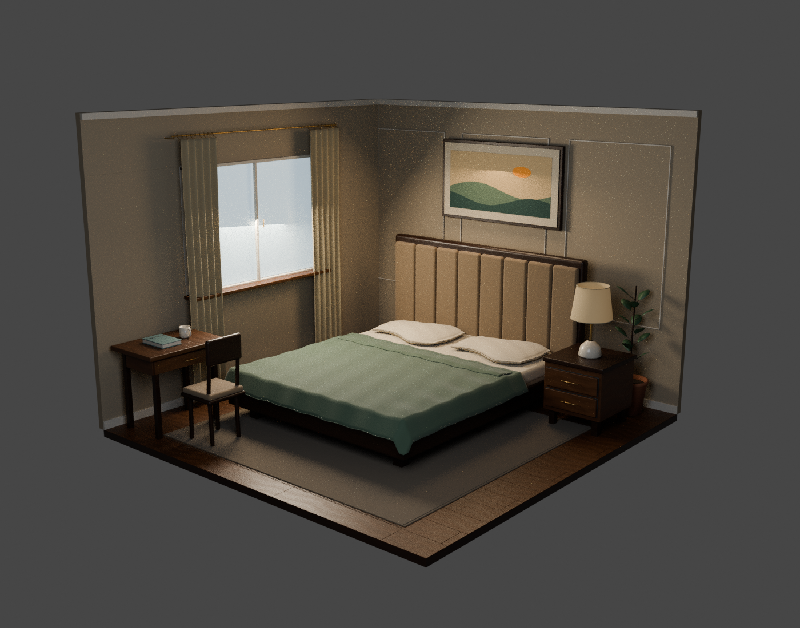
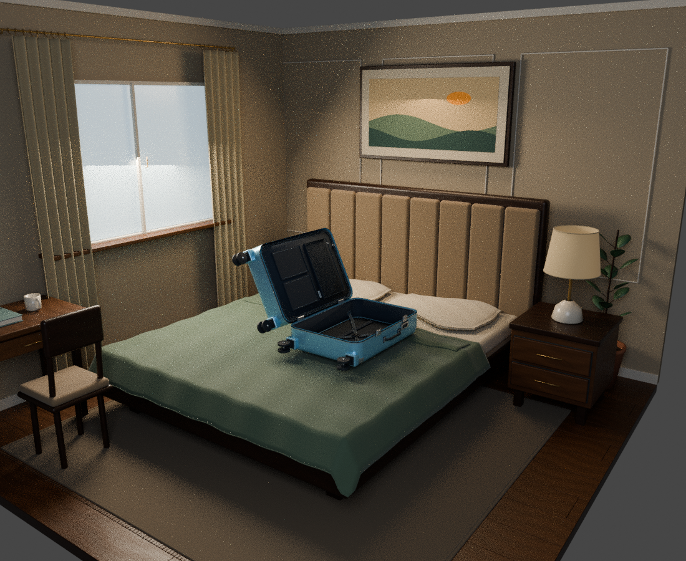

# 아나모픽 3D 영상 제작 작업 파일

이 대화에서 제작한 캐리어, 여행 소품, 티셔츠 수정본, 침실 배경의 모델·텍스처·소스·검토 렌더를 보관합니다. 이전 버전과 Blender 자동 백업(`.blend1`)도 함께 보존했습니다.

## 다운로드

아래 **ZIP 다운로드** 링크를 클릭합니다. GitHub 로그인 화면이 나오면 이 저장소에 접근 가능한 계정으로 로그인하세요.

| 작업 | 다운로드 | 용량 | 상태 |
| --- | --- | ---: | --- |
| 침실 / 방 v01 | [ZIP 다운로드](https://github.com/a2annie-sj04/all-project/raw/refs/heads/main/assets/bedroom_v01.zip) | 23.0 MB | 최신 방 모델 |
| 캐리어 v05 | [ZIP 다운로드](https://github.com/a2annie-sj04/all-project/raw/refs/heads/main/assets/suitcase_v05.zip) | 10.2 MB | 내부 수납 구조 포함 최신 캐리어 |
| 여행 소품 v01 | [ZIP 다운로드](https://github.com/a2annie-sj04/all-project/raw/refs/heads/main/assets/travel_props_v01.zip) | 18.2 MB | 옷·운동화·파우치·모자 초안 / 현실감 보완 필요 |
| 티셔츠 수정 v02 | [ZIP 다운로드](https://github.com/a2annie-sj04/all-project/raw/refs/heads/main/assets/tshirt_realism_v02.zip) | 15.2 MB | 현실감 개선 방향 검토본 / 실사 완성본 아님 |
| 캐리어 v04 | [ZIP 다운로드](https://github.com/a2annie-sj04/all-project/raw/refs/heads/main/assets/suitcase_v04.zip) | 8.4 MB | 이전 버전 / 바퀴 장착 구조 수정 |
| 캐리어 v03 | [ZIP 다운로드](https://github.com/a2annie-sj04/all-project/raw/refs/heads/main/assets/suitcase_v03.zip) | 6.3 MB | 이전 버전 / 접합부 디테일 수정 |
| 캐리어 v02 | [ZIP 다운로드](https://github.com/a2annie-sj04/all-project/raw/refs/heads/main/assets/suitcase_v02.zip) | 4.1 MB | 이전 버전 / 외곽과 바퀴 계층 수정 |
| 캐리어 v01 | [ZIP 다운로드](https://github.com/a2annie-sj04/all-project/raw/refs/heads/main/assets/suitcase_v01.zip) | 3.9 MB | 첫 초안 |

링크에서 파일 정보 화면이 열리면 오른쪽의 **Download raw** 버튼으로 받으세요. 저장소 전체는 상단 **Code → Download ZIP**으로 받을 수 있습니다. 전체 저장소는 이전 버전과 편집 원본까지 포함하므로 작업별 ZIP보다 용량이 큽니다.

## 집 컴퓨터에서 열기

1. 원하는 ZIP을 내려받아 압축을 풉니다.
2. 3ds Max에서 시스템 단위를 **centimeters**로 설정하고 `.fbx`를 가져옵니다.
3. `textures` 폴더를 모델과 함께 보관합니다. 재질이 누락되면 해당 이미지 경로를 연결합니다.
4. 각 폴더의 `README_KO.md`에 부품 조작과 가져오기 정보를 적었습니다.

`.blend`는 Blender 편집 원본입니다. `.max` 파일은 생성하지 않았습니다. Unreal에서 조명·재질을 최종 조정해야 합니다.

## 폴더

| 폴더 | 내용 |
| --- | --- |
| [assets/bedroom_v01](assets/bedroom_v01/) | 방 FBX/GLB, 재질, 편집 원본, 캐리어 배치 검토, 화면별 카메라 참고 |
| [assets/suitcase_v05](assets/suitcase_v05/) | 최신 캐리어: 내부 안감·고정벨트·지퍼 칸막이·포켓 |
| [assets/travel_props_v01](assets/travel_props_v01/) | 여행 소품 초안과 캐리어 수납 검토 |
| [assets/tshirt_realism_v02](assets/tshirt_realism_v02/) | 티셔츠 현실감 개선 검토본 |
| [assets/suitcase](assets/suitcase/) | 캐리어 첫 초안 |
| [assets/suitcase_v02](assets/suitcase_v02/), [v03](assets/suitcase_v03/), [v04](assets/suitcase_v04/) | 캐리어 이전 수정 버전 |

## 방 미리보기

## 제작 기준과 검증 범위

- 화면 한 면: **64 × 48cm**, **256 × 192px**, 두 면 사이 각도 **90도**.
- 두 면의 가로 연결 해상도: **512 × 192px**.
- 관람 위치: 모서리 정면에서 수평거리 **150cm**, 눈높이는 화면 중앙인 **24cm** 가정.
- 방은 이 화면 구성에 맞춘 가상 공간이며, 일반 성인 침실의 실측 크기가 아닙니다.
- 방 배치 검토에서 캐리어 v05는 **0.48배 균일 축소**했습니다. 캐리어 원본은 유지했습니다.
- Blender에서 FBX 재가져오기·치수·일부 접합/관통·화면 투영 검사를 수행했습니다. 세부 결과는 각 폴더의 검증 JSON에 있습니다.
- **3ds Max/Unreal 직접 실행, 실제 LED/nDisplay 출력, 최종 실사 품질 검증은 하지 않았습니다.** 화면 JSON은 Blender 좌표의 참고 자료이며 검증된 `.ndisplay` 설정 파일이 아닙니다.
- 의류와 소품은 정적 모델입니다. 천 시뮬레이션, 자동 접힘·펼침, 수납 애니메이션은 포함하지 않습니다.
- 옷/여행 소품은 초안 상태로 보관했고, 이후 작업은 방 제작으로 전환했습니다.

## 파일 확인

[ASSET_INVENTORY.json](ASSET_INVENTORY.json)에 모든 작업 파일의 경로·크기·SHA-256을 기록했습니다. ZIP 무결성도 업로드 전에 검사했습니다.
